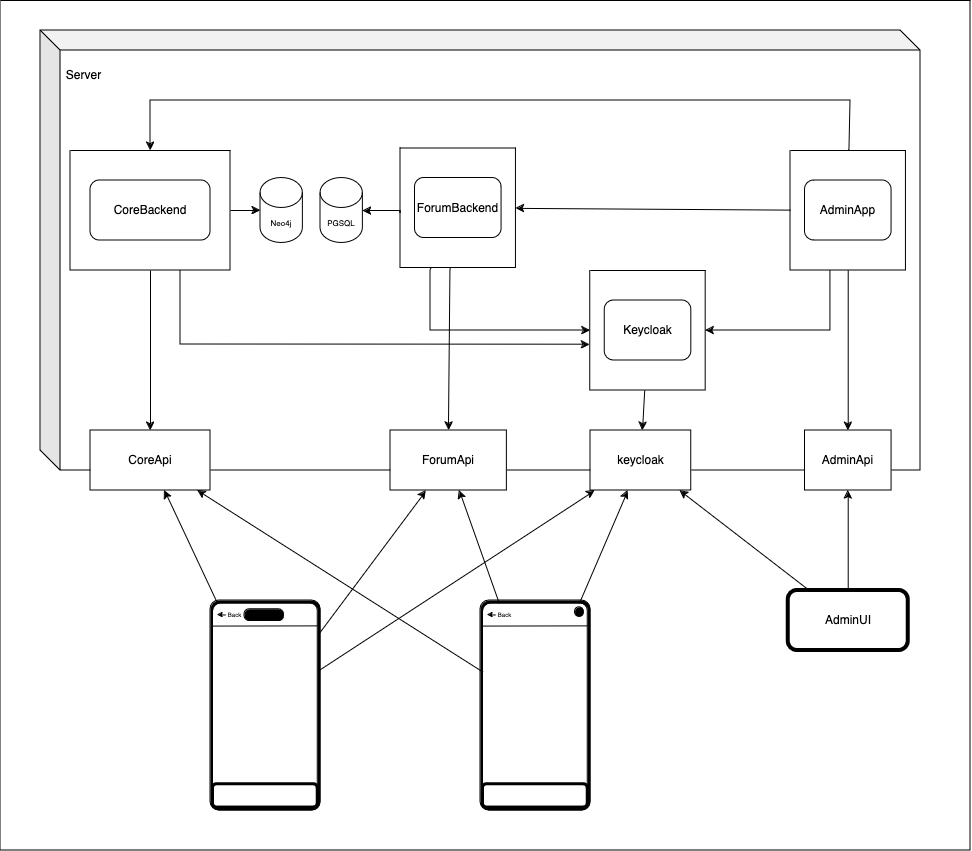
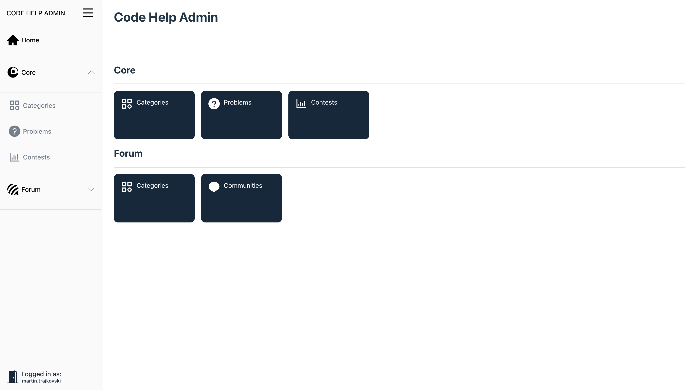
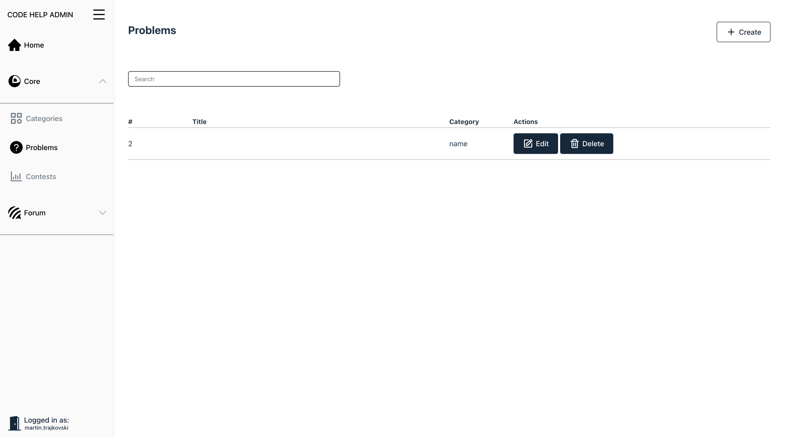
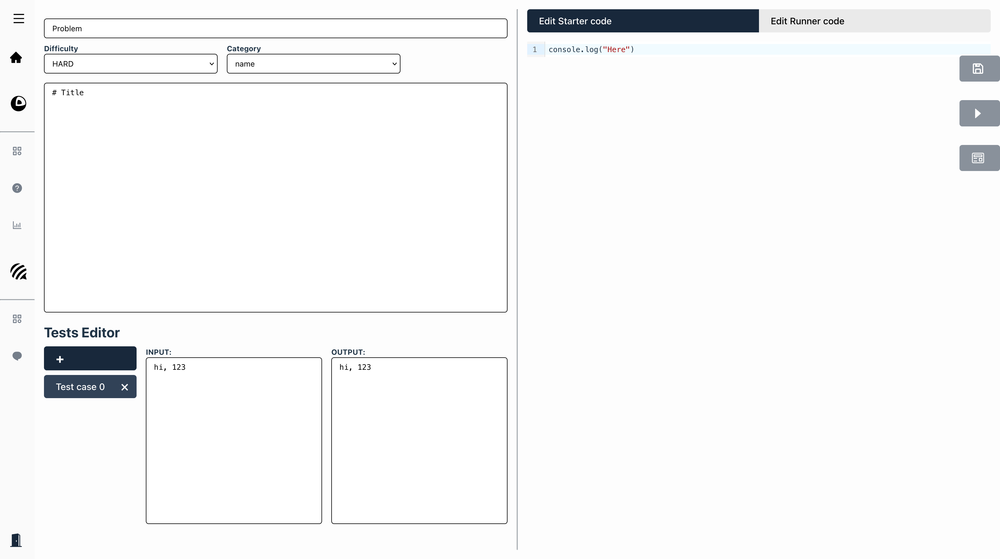
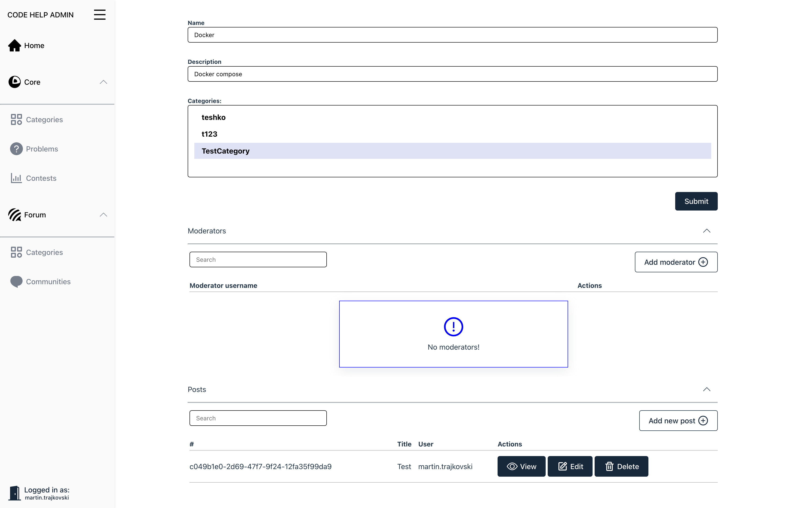
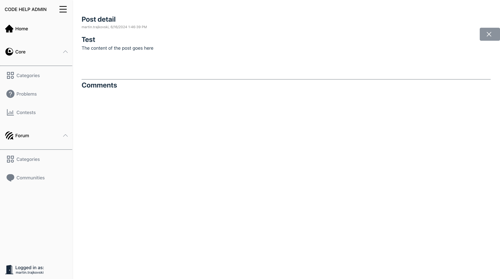

# Code Help

## Вовед

Апликацијата е наменета како помагало за кодирање, и дискусии на компетитивни програмери истомисленици, организирани низ форуми со одредени теми, апликацијата им овозможува на корисници да извршуваат код на далечина, при што корисници имаат можност да решаваат различни алгоритамски задачи или проблеми кои наликуваат на останати натпреварувачки апликации наменети за кодери.

## Инсталација

### Локално

#### Основната серверска апликација

##### Потребни алатки:

- [maven](https://maven.apache.org/)
- [Java 17](https://openjdk.org/)
- [Neo4j](https://neo4j.com/)
- [keycloak](https://www.keycloak.org/)

##### Потребни конфигурациски опции:

```properties
# Database Proeprties
spring.neo4j.uri: jdbc:postgresql://localhost:5432/code_help
spring.neo4j.authentication.username: neo4j
spring.neo4j.authentication.password: password

# Oauth2
spring.security.oauth2.resourceserver.jwt.issuer-uri: http://localhost/iam/realms/code-help
spring.security.oauth2.resourceserver.jwt.jwk-set-uri: http://localhost:8080/iam/realms/code-help/protocol/openid-connect/certs
```

```yaml
# Database Proeprties
spring:
	neo4j:
		authentication:
			username: neo4j
			password: password
		uri: bolt://localhost:7687
	security:
		oauth2:
			resourceserver:
				jwt:
					issuer-uri: http://localhost/iam/realms/code-help
					jwk-set-uri: http://localhost:8080/iam/realms/code-help/protocol/openid-connect/certs
```

##### Корисни команди

```sh
cd code-help-core

mvn clean install # jar file generated in target/APPNAME-version.jar

mvn spring-boot:run # start the spring app in development mode

java -jar code-help-core-app-0.0.1-SNAPSHOT.jar # start from jar file

java -jar code-help-core-app-0.0.1-SNAPSHOT.jar -Dspring.datasource.username=otherUser # override property

mvn spring-boot:run -Dspring.neo4j.authentication.username=otherUser # override property

```

#### Форум апликација:

##### Потребни алатки:

- [maven](https://maven.apache.org/)
- [Java 17](https://openjdk.org/)
- [PostgreSQL](https://www.postgresql.org/)
- [keycloak](https://www.keycloak.org/)

##### Потребни конфигурациски опции

```properties
# Database Proeprties
spring.datasource.url: jdbc:postgresql://localhost:5432/code_help
spring.datasource.username: user
spring.datasource.password: password

# Oauth2
spring.security.oauth2.resourceserver.jwt.issuer-uri: http://localhost/iam/realms/code-help
spring.security.oauth2.resourceserver.jwt.jwk-set-uri: http://localhost:8080/iam/realms/code-help/protocol/openid-connect/certs
```

```yaml
spring:
	datasource:
		url: jdbc:postgresql://localhost:5432/code_help
		username: user
		password: password
	security:
		oauth2:
			resourceserver:
				jwt:
					issuer-uri: http://localhost/iam/realms/code-help
					jwk-set-uri: http://localhost:8080/iam/realms/code-help/protocol/openid-connect/certs
```

##### Корисни команди

```sh
cd code-help-forum

mvn clean install # jar file generated in target/APPNAME-version.jar

mvn spring-boot:run # start the spring app in development mode

java -jar code-help-forum-0.0.1-SNAPSHOT.jar # start from jar file

java -jar code-help-forum-0.0.1-SNAPSHOT.jar -Dspring.datasource.username=otherUser # override property

mvn spring-boot:run -Dspring.datasource.username=otherUser # override property

```

#### Админ апликација

##### Потребни алатки:

- [go](https://go.dev/)
- [keycloak](https://www.keycloak.org/)

##### Потребни конфигурациски опции

> Конфигурациските опции се читаат од оперативниот систем доколку се поставени.
>
> [Linux/macOS](https://www.man7.org/linux/man-pages/man1/env.1.html), [Windows](https://learn.microsoft.com/en-us/powershell/module/microsoft.powershell.core/about/about_environment_variables?view=powershell-7.4)
>
> [Linux/macOS using export](https://www.man7.org/linux/man-pages/man1/export.1p.html) > [Linux/macOS using set](https://man7.org/linux/man-pages/man1/set.1p.html)

```
	CORE_ADMIN_API_SERVER_URL=http://localhost:3000/api
	FORUM_API_SERVER_URL=http://localhost:3001/api/v1
	OAUTH2_RESOURCESERVER_JWT_ISSUERURI=http://localhost/iam/realms/code-help
	OAUTH2_RESOURCESERVER_JWT__DISCOVERYISSUERURI=http://localhost/iam/realms/code-help
	OAUTH2_RESOURCESERVER_JWT_JWKSETURI=http://localhost/iam/realms/code-help/protocol/openid-connect/certs
```

##### Корисни команди

```sh
cd code-help-admin/code-help-admin-backend

go mod download # download dependencies

go build ./admin-api/cmd/main.go

./main # Run the built app

go run ./admin-api/cmd/main.go # Run without building

```

#### Админ кориснички интерфејс

##### Потребни алатки:

- [nodejs](https://nodejs.org/en)
- [pnpm](https://pnpm.io/installation)
- [keycloak](https://www.keycloak.org/)

##### Потребни конфигурациски опции

> Конфигурациските опции се поставуваат во папката со проектот во датотека со име `.env.local`

```.env
VITE_ADMIN_API_URL=http://localhost/admin/api/v1
VITE_KEYCLOAK_URL=http://localhost/iam
VITE_KEYCLOAK_REALM=code-help
VITE_KEYCLOAK_CLIENTID=code-help-flutter
VITE_BASE_ROUTE=/
```

##### Корисни команди

```sh

# Insall pnpm
corepack enable pnpm

# Install dependencies
pnpm install
npm run install

# Build the application to `dist` folder
# Can be served by nginx, vscode live server, sirv, vite
pnpm build
npm run build

# Start in development mode
pnpm dev
npm run dev

# Start from a built `dist` directory
pnpm preview
npm run preview

```

### Контејнери

##### Потребни алатки:

- [Docker](https://www.docker.com/)
- [Docker compose](https://docs.docker.com/compose/)

##### Објаснување

Се користи `docker-compose.yaml` датотеката, каде претходно се поставени сите конфигурациски опции, потоа се користи портата 80, и апликацијата се пристапува преки `http://localhost/admin-ui`.

##### Корисни команди

```sh
docker compose up
```

#### Keycloak

Претходно поставен корисник:

```
username: martin.trajkovski
password: mt
```

### Инсталација на мобилните апликации

#### Андроид апликацијата

##### Потребни алатки

- maven
- flutter
- dart

##### Дизајн

- [Figma дизај](https://www.figma.com/design/jPnnbfNqoAwo7Cn1DNMH5M/Coding-helper?node-id=0-1&t=seXueaDKHNTkP7DZ-0)
- [Протип](https://www.figma.com/proto/jPnnbfNqoAwo7Cn1DNMH5M/Coding-helper?node-id=0%3A1&t=Ov7dI0u7oWTtRXqm-1)

##### Корисни команди

###### Maven

```sh
#Build project:
mvn clean install

# Build project by project:
mvn clean install -pl code-help-forum
mvn clean install -pl code-help-core
mvn clean install -pl code-help-mobile-ui

# Run projects:
flutter run
java -jar code-help-forum/target/code-help-forum-0.0.1-SNAPSHOT.jar
java -jar code-help-core/code-help-core-app/target/code-help-core-app-0.0.1-SNAPSHOT.jar
```

###### Flutter

```sh
# Get dependencies and generate types:
flutter pub get
flutter pub run build_runner build --delete-conflicting-outputs

# Run:
flutter run --dart-define="CODING_HELPER_FORUM_API_URL=http://10.0.2.2/forum" --dart-define="CODING_HELPER_API_URL=http://10.0.2.2/core" --dart-define="AUTH_ISSUER_URL=http://10.0.2.2/iam/realms/code-help"

# Appbundle build:
flutter build appbundle --dart-define="CODING_HELPER_FORUM_API_URL=http://10.0.2.2/forum" --dart-define="CODING_HELPER_API_URL=http://10.0.2.2/core" --dart-define="AUTH_ISSUER_URL=http://10.0.2.2/iam/realms/code-help"

# Apk build:
flutter build apk --dart-define="CODING_HELPER_FORUM_API_URL=http://10.0.2.2/forum" --dart-define="CODING_HELPER_API_URL=http://10.0.2.2/core" --dart-define="AUTH_ISSUER_URL=http://10.0.2.2/iam/realms/code-help"
```

#### iOS Апликација

##### Потребни алатки

- [xcode](https://developer.apple.com/xcode/) (mac only)

##### Дизајн

- [Figma дизај](https://www.figma.com/design/jPnnbfNqoAwo7Cn1DNMH5M/Coding-helper?node-id=0-1&t=seXueaDKHNTkP7DZ-0)
- [Протип](https://www.figma.com/proto/jPnnbfNqoAwo7Cn1DNMH5M/Coding-helper?node-id=0%3A1&t=Ov7dI0u7oWTtRXqm-1)

## Состав

- Сервер апликација со основните функционалнисти на апликацијата | spring | java
- Сервер апликација со функционалности за форум | spring | kotlin
- Админ сервер апликација | n/a | golang
- Кориснички интерфејс за админ апликацијата | svelte | javascript / typescript
- iOS Апликација | swiftUI | swift
- Android Апликација | flutter | dart
- Автентикација | keycloak | java
- Контејнеризација со користење на docker и compose
- CI/CD цевковод
- База на податоци за форум апликацијата | postgresql
- Граф база на податоци за чување на проблеми | neo4ј

## Кориснички интерфејси (iOS, Android)

Системот се состои од еднa клиентска апликација за андроид изработен со користење на flutter и dart програмскиот јазик, исто така изработена е клиентска апликација за ios со користење на swiftui која претставува рамка во swift програмскиот јазик изработен од apple, моментално ова се основните клиенти, при што flutter нуди поддршка за веб апликации, сите клиенти ги имаат истите поддршки, исто така имаат изглед во зависност од платформата, при што корисниците нема да осетат разлика помеѓу својот оперативен систем и апликациите. Овозможено му е на корисникот да извршува код при што го решаваат проблемот, и во позадина се извршуваат тестови за кои кориникот добива резултат и се прикажува на корисничкиот интерфејс.

Flutter како рамка за граденење на апликации е слична со react каде се креираат компоненти и се вгнездуваат една во друга и изгледа на едно големо дрво во кое апликацијата почнува од една точка, но за разлика од react во flutter наместо методи се користат класи, односно објектно програмирање, додека јазикот dart е истовремено премногу строг за типовите и недоволно строг, при што се наидува на премногу грешки и лимитации во кодот на кој треба да се внимава.

SwiftUI е сличен со flutter, каде исто така работи на декларативно ниво, со разни компоненти, но има подобар модел на организација, и менаџирање на состојбата, додека програмскиот јазик swift наликува многу повеќе на јава и golang, се разбира дека има свои нелогични комплексности, но е подобар во однос на dart.

## Автентикација

За автентикација се користи keycloak, која претставува алатка што имплементира повеќе протоколи како што се OAuth2, OpenID, SAML, оваа алатка се грижи за автентикацијата, улогите на корисниците, и пристапот до ресурсите, додека за некои јазици и рамки (frameworks) има можност да се интегрира, додека пак доколку нема готова библиотека да се направи тоа, потребно е рачно да се имплементира целиот тек (flow) на keycloak автентикација (што беше случајот со ios апликацијата и golang апликацијата).

При иницијализација на страна каде е потребно корисникот да е автентициран, има можност да се пренасочи на keycloak портал за најава, за кој има можност да се промени изгледот со користење на css, потоа при внесување на потревните информации корисникот се пренасчува назад кон линкот што предходно неможел да го пристапи.

Оваа алатка нуди безболна интеграција на многу познати провајдери за автентикација како што се Google, Apple, Microsoft итн. Но исто така се нуди интеграција на прилагодени системи за автентикација (најчесто интерни системи користени од страна на фирми) како што се AzureAD, Google cloud iam итн.

## Основна серверска апликација

Основната серверска апликација е напишана со користење на spring и е класична јава апликација, која овозможува извршување на код со користење на компајлер или интерпретер, при што како аргументи се испраќаат предходно внесените информации во така наречените testCases, кои ги внесува корисник при креирање на кодот.

Апликациите се состојат од два вида на код, едниот е така неречен „почетен код“ кој служу за парсирање на аргументите кои подоцна ги испраќа на понатаму и ја повикува главната „функција“ (доколку е метод) со тие аргументи, се повикува онолку пати колку што има тестови.

Алгоритамските проблеми се организирани во датотеки, при што се состојат од два датотеки со извршен код, една е напишана од корисникот што ја решава задачата, додека другата е напишана од страна на создателот на задачата и служи за „поставување“ и „подготовка“ за корисничкиот код, и дополнително тука спаѓаат исто така и датотеките за сите тест случаеви кои има можност да се организирани било како и подоцна се испраќаат како обичен текст на кодот кој служу за подготовка за корисникот, каде што се очекува од човекот кој ја прави задачата да ги постави и да ги парсира и да ги испрати на корисникот за да го тестира својот код врз основ на претходно споменатите тест случаеви.

Апликацијата сите датотеки ги чува во рамки на базата на податоци односно neo4j, тоа е граф база на податоци која овозможува комплексни поврзувања, датотеките се чуваат во бинарен формат, и исто така корисник има можност истите да ги спушти како датотеки на својата локална машина.

Апликацијата на корисниците им овозможува пребарување на самостојни проблеми, решавање на истите, извршување на кодот наспроти тест случаеви кои се претходно дефинирани и зачувување на „омилени“ проблеми, но исто така им овозможува натпреварување помеѓу корисниците, каде секој корисник добива одреден број на поени со секој алгоритамски проблем решен во рамки на еден „натпревар“ (contest).

Апликацијата е организирана така што во позадина е потредно некој на менаџура со проблеми, да ги креира преку админ апликацијата, и тука има можност да ги групира повеќе проблеми во рамки на еден натпревар, кој подоцна има можност да го закажи за во одредено време, подоцна тој натпреван е видлив од страна на корисниците и тие имаат можност да го гледаат но не можат да ги гледаат проблемите додека не започне натпреварот, кога ќе заврши еден натпреват, корисниците ги добиваат проблемите како поединечни проблеми надвор од натпреварот за решавање.

Апликацијата е организирана како класична јава апликација со папка за главниот код `java` и `test`

## Форум апликацијата

Примарната примена на форум апликацијата е дискусија помеѓу различни групи на луѓе и поставување на прашања поврзани со одреден проблем, алгоритам, појаснување на некои концепти, искажување на своето мислење.

Форум апликацијата просторот за дискусија го организира на начин што за секоја тема (topic) се создава „заедница“ (community), и во таа заедница се врши модерација од страна на дезигнирани модератори, кои имаат можност да бришат постови и бркаат корисници, секое заедница се состои од повеќе модератори, но имаат само еден администратор, кој има можност за поставување на модератори, одземање на модераторски права.

Доколку корисниците сакаат додавање на нова заедница потребно е да исконтактира администратор, кој ќе направи ново заедница преку админ апликацијата, и потребно е од негова страна да пронајди администратор, или да остани како администратор и да бара модератори кои ќе се грижат за околината.

Секој корисник можи да остави објава, на која подоцна можат корисници да коментираат или да вратан на некој коментар, доколку не се задоволни од својот коментар имаат можност да го избришат, истото важи и за објавата.

Форум апликацијата е изработена користејќи ја spring рамката, но наместо јава се користи kotlin како програмски јазик, кој е доста пофлексибилен од јава, има поддршка за многу помодерни карактеристики, при што дозволува пишување на помалку код за да се постигни нешто еквивалентно на јава, има потполна интероперабилност со постоечки јава код, и дозволува мешање и повикување на јава класи и функционалности во рамки на kotlin код.

## Админ апликација

### Сервер апликацијата

Админ апликацијата се состои од еден сервер кој го комуницира со останатите апликации, и им нуди на корисниците кои се овластени да креираат проблеми, натпревари, дополнително администраторите тука имаат можност да направат нова заедница, да доделат модератори, да бришат постови и коментари.

При креирање на задачи на корисникот му се овозможува интуитивен преглед на задачата, каде што има можност да внеси тест случаеви, кои подоцна ги парсира со припремниот код кој го внесува и потоа го повикува кодот од крајниот корисник.

Оваа апликација е пишувана користејќи го golang, и е структурирана во една стандардна форма на организација на апликации пишувани во golang како што е претставено на следниот [линк](https://github.com/golang-standards/project-layout). При што главниот влез во апликацијата или така наречениот entrypoint, се наоѓа во `cmd` папката, каде рачно се инстанцираат сите зависности, сервиси, слушатели, декодери, мапери итн.

Јазикот golang е доста едноставен, и според функционалност е сличен со `c` но се додадени модерни концепти како што се: чување, праќање и враќање на референци до методи, со што се овозможува користење на некои карактеристики од функционални јазици, потоа се додадени интерфејси, што служат за апстракција на имплементацијата, генерички типови, goroutines за паралелност, враќање на повеќе вредности од една функција итн. Но за разлика од `c` јазикот е многу пофокусиран за градење на микро-сервиси, тука јазикот е едноставен, цела припрема на сервисот се одвива во една функција, нема тешки зависности, има добри примитиви за различни веб технологии, при тоа програмерите немаат потреба од коирстење на комплицирани веб рамки како што е `spring` за јава. Најчесто се користи за пишување на микро-сервиси, но не е тоа единствената намена, слободно може да се користи за пишување на целосна апликација, при што кодот најчесто е организиран низ модули, и е препорачливо да се гради цела апликација во една главна влезна даторека без користење на инјекција на зависности (dependency injection), но се разбира дека многу често се прекршуваат препораките од луѓето што го направија јазикот, и постојат популарни библиотеки за ова, една од нив е направена од Google и се нарекува [Wire](https://github.com/google/wire).

Gо заедницата, е доволно голема и има доста интересни библиотеки за било што, но многу придонесува тоа што е премногу лесто да се направи нова библиотека, што влучува само креирање на модул со одредено име, и поставување (најчесто )на github, потоа преку терминал можи да се превземи таа библиотека користејќи ја `go get` командата.

Синтаксата на golang е слаба страна, додека постојат јазици каде се си има посебна синтакса (syntactic sugar), во go тоа е сведено на минимално, како еден пример за ова е тоа што не постои класичниот тернарен оператор односно: `i == 0 ? "isFisrt" : "other"` е валидна синтакса за многу јазици но во го ова не е валидно, додека во јазици како kotlin и java кодот почува да се шири хоризонтално во go, тој се шири вертикално, каде се прават проверки експлицитно со користење на if структурата.

Но јака страна е тоа што најчесто користените примитиви и чести шеми/шаблони се вградени односно спакувани како библиотеки во стандардна go инсталација, при што овие имплементации се доста добри, и ретко има потреба од инсталација на библиотеки за одредена примена.

Во golang апликации, за разлика од помодерни веб рамки, нема автоматска десеријализација на телото на http барањето, туку сите постоечки рамки, вклучувајќи го и самиот јазик имаат импленетација која од корисникот бара да работи директно со http барањето и одговорот.

Овој јазик исто така има своја имплементација за темплејти, која е доволно моќна и се корисни во алатки како што се helm за ргадење на kubernetes (k8s) ресурси, се користи за градење на html одговор притоа на овој пристап се надоврзуваат библиотеки како [htmx](https://htmx.org/) која служи за замена на популарните SPA (single pаge app) и се оди на нешто што се користело претходно наречено SSR (server side rendering) каде за одредена страна серверот прво ја гради во моментот кога клиентот ја побарал и ова остава можност за кеширање на страницата.

Апликацијата за да овозможи хостирање во облак, потребно е да е пријателски настроена на таа околиза, за таја цел е потребно кога апликацијата прави за иницијализација потребно е да се направи механизам за повторување, користејќи ги примитивите на јазикот тоа е доста едноставно да се имплементира каде се прави повик на секои 5 секунди додека бараниот сервис не отпочне со опслужување на барање, ова можи да се види во следниот код, каде што се користат goroutines за извршување на тајмер кој на секои 5 секунди, пушта на канал (channel) со име `C` некаков податок, а нашиот код слуша на тој податок, и секогаш кога ќе се добие вредност се извршува добиенот метод преку аргумент со името task, дополнително исто така се проверува дали задоволува одреден услов (condition), доколку се задоволи тој услов апликацијата ја прекинува рутината со користење на наш канал нареќен `quit`, на кој исто така слушаме за промени, и кога ќе го затвориме со користење на вградениот метод во go нареќен `close()`, се испраќа сигнал до следниот „случај“ (case) каде го стопираме тајметор и го одблокираме групата на чекање, користејќи ја променливата `wg` како мутекс или семафор, со што кога се одблокира, се завршува главната функција и се излегува од бесконечниот циклус користејќи го `return` резервираниот збор, со што се спречува протекување на меморија (memory leak).

```go
func retry(task func(), condition func() bool) {
    var wg sync.WaitGroup
    ticker := time.NewTicker(5 * time.Second)
    quit := make(chan struct{})
    wg.Add(1)
    go func() {
       for {
          select {
          case <-ticker.C:
             log.Println("Retrying...")
             if condition() {
                close(quit)
             } else {
                task()
             }
          case <-quit:
             ticker.Stop()
             wg.Done()
             return
          }
       }
    }()

    wg.Wait()
}
```

Тестови се пишуваат најчесто на исто место заедно со изворниот код, со исто име со датотеката но со додаден суфикс, пример: `main.go` е името на изворната датотека а `main_test.go` е името на тестот, и е автоматски препознаено како тест датотека,секоја функција претставува еден тест.

Поради тоа што јазикот е доста едноставен, и луѓето што работат на него гледаат да го чуваат едноставен, голема придобивка од тоа е што времено за градење на извршна датотека е доста мало, можи да се смета и за инстантно, ова исто важи и за поголеми апликации.

### Кориснички интерфејс

Корисничкиот интерфејс беше изработен со користење на по нова, но доста популарна јаваскрипт рамка наречена svelte. Тоа е рамка во која на крајот целиот код се компајлира од svelte компајлерот во едена датотека „пакет“ наречен bundle.js, кој зафаќа простод одолу 2kb, за разлика од react, кој зафаќа во просек дваесет пати повеќе, бидејќи на react му е потребно да ja иницијализира целата DOM структура со така нареќен shadow DOM, кој работи паралелно и следи промени или интеракции од корисникот, додека во svelte, се работи директно со користење на јаваскрипт за манипулација на обичниот DOM.

Како и секоја друга јаваскрипт рамка исто и svelte е струкруриран во компоненти, има една главна компонента која се поставува не еден html елемент и подоцна компајлираниот код иницијализира се останато, интерно за сите компоненти се креира класа која може да се повика од било која страна без зависности.

пример:

```ts
import './app.css';
import App from './CodeHelpAdminApp.svelte';

const app = new App({
  target: document.getElementById('app') as Element,
});

export default app;
```

```html
<!DOCTYPE html>
<html lang="en">
  <head>
    <meta charset="UTF-8" />
    <meta name="viewport" content="width=device-width, initial-scale=1.0" />
    <title>Code Help Admin</title>
  </head>
  <body>
    <div id="app"></div>
    <script type="module" src="/src/main.ts"></script>
  </body>
</html>
```

Вака изгледа html кодот кој се испраќа на клиентот, датотеката во `script` тагот се заменува со `index-[hash].js`, притоа почетната погоре е онаа која ќе ја иницијализира цела апликација, и ќе го добиеме цел преглед на страницата.

За разлика од останати јаваскрипт рамки, svelte се фокусира на основните функционалности кои ги веќе се понудени од јаваскрипт или од самиот html, еден пример за тоа се слотовите, нема своја имплентација туку ги користи слотовите веќе импленетирани од страна на html, многу почесто се користат `а` тагови за навигација отколку функционалност обвиена во компонента, која подоцна е многу тешко да се стилизира.

Svelte исто така го олеснува создавањето на наши настани (events), при тоа ние сме тие кои ќе му зададеме тип, односно ја дефинираме структурана на настаните кои ги фрламе.

```ts
const dispatch = createEventDispatcher<{
  error: Error;
  success: void;
}>();
```

Подоцна го испраќаме тој настан со името, и податокот кој го сорджи.

```ts
dispatch('error', err);
dispatch('success');
```

И на секоја компонента што подава свои настани ние можеме да слушаме на тој настан со следната синтакса, притоа доколку сакаме да го проследиме тој настан нагоре, потревно е само да оставиме празен атрибут со името на настанот, во кодот долу имаме една имплементација за on:success настан кој прави нешто во оваја функција, но исто така поради празниот атрибут овој настан ќе се проследи нагоре во родителот на оваја моменталната компонент.

```html
<Component on:success on:success={(e) => console.log(e)} />
```

Друг доста интересна работа што ја нуди svelte се складиштата на состојба (stores), при користење се врши субсцрипција, која можи да се иницира со користење на специјален знак во името на променливата односно доколку променливата се вика `store`, доколку сме во svelte компонента имаме можност да додадеме префикс: `$store`, кој во позадина автоматски повикува `subscribe` методот и добиваме податоци. но доколку извржуваме код надвор од svelte компонента мора да се повика или `subscribe` методата рачно, или доколку ни е потребна само моменталната состојба без да слушаме за промени на вредноста може да се искористи `get(store)` методот кој ни е даден од svelte.

Дополнително имаме и таканаречени derivedStores, тоа се наследени складишта, и нив имаме можност само да ги читаме но не и да запишуваме во нив, тие имаат само `subscribe` метод, и со секоја промена на зависностите, во кодот подоло `derivedStore` зависи само од `store` доколку се промени вредноста запишана во `store` автоматски се извршува методот во `derivedStore`.

```ts
const store = writable('hello');
const derivedStore = derived([store], ([$store]) => {
  console.log($store);
});
const customStore = (): Writable<string> => {
  const internalStore = writable('Other');

  return {
    subscribe: internalStore.subscribe,
    set: internalStore.set,
    update: internalStore.update,
  };
};
```

За реактивност се користи симболот `$` при што доколку се отвори ваков блок во било која компонента доколку се направи промена во вариаблите користени било каде се преповикува кодот во овој блок, истото важи и за сторови, доколку една од нив се промени ќе се повика соодветниот блок.

```ts
let innerVariable = '123';
$: console.log('Hello', innerVariable);
$: console.log($store);
$: console.log($derivedStore);
$: console.log($customStore);
```

## Генерален преглед

На следната слика е прикажан преглед на тоа, како функционира апликацијата и текот на комуникација, како што можи да се види од сликата, сите комуницираат со сервисот за автентикација, а тоа во нашиот случај е keycloak, при тоа корисникот се автентицира преку веб страницата што ја нуди keycloak, а потоа keycloak не пренасочува на нашата апликација каде добиваме токен и го испраќаме на соодветната апликација, подоцна овој токен се верифицира од страна на апликацијата со повик до сервисот за автентикација и во зависност од кои привилегии ги има корисникот се извршува соодветната логика.

Како што е виддливо на сликата нема едно заедничка точка на пристап до серверот, туку потребно е клиентсата апликација да го познава соодветниот сервис што го повикува, додека пак, интерна комуникација имаме од страна на админ апликацијата која внатрешно комуницира со останатите апликации.



На следната слика можи да видиме како излгеда апликацијата при што се прикажани сите ресурси кои што можи да се менуваат од страна на автентициран админ корисник.



Сите ресурси си имаат свои табели за преглед на самите и форми за креирање и менување и бришење на истите.



На следната слика е прикажан преглед за тоа како се изменува еден проблем,
и тука се прикажани: едитор за markdown јазик, каде се пишива тектс за проблемот, а потоа десниот служи за пишување на почетен код кој што го гледа корисникот и така наречен runner code за кој претходно беше споменато дека служи за парсирање на тест случаевите и помошен дел за да функционира кодот од корисникот.

Подоцна за да се заштеди простор, како лебдечки копчиња се поставени комчиња за целокупен преглед на задачата, за зачувување на состојбата и дел што ги вклучува тестовите.



На следната слика е претставен поглед преку кој се креира нова заедница, или се прават измени на истата, од тука имаме преглед за сите постови во неа, и секој пост можи да биди маркиран за непристоен, да биде избришен или доколку е од ист корисник како админ корисникот да биде едитиран.

Исто така се дозволува на админ корисниците додавање на модератори, кои добиваат дополнителни привилегии во рамки на едно опшество.



На следната слика е прикажан како изледа прегледот на еден пост.


